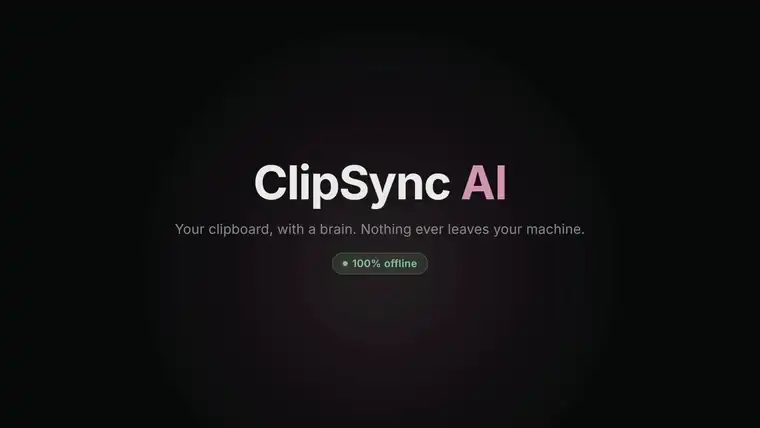
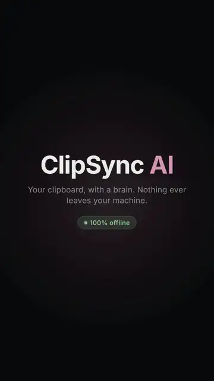
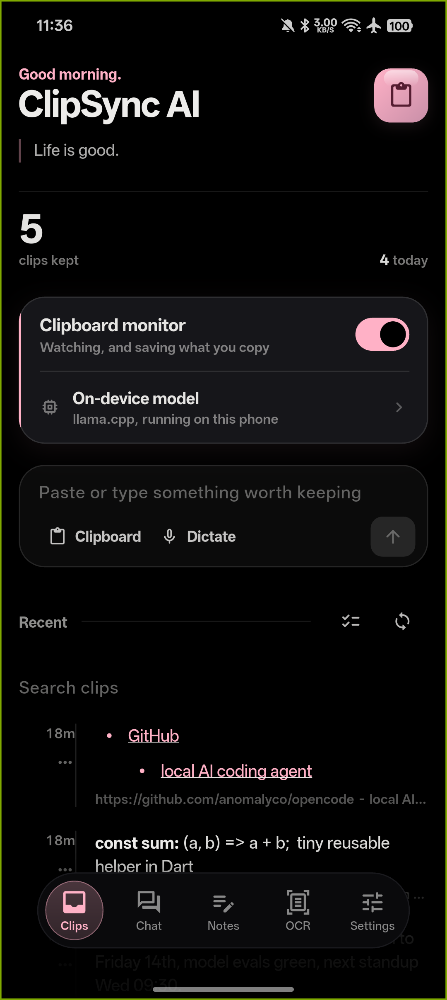
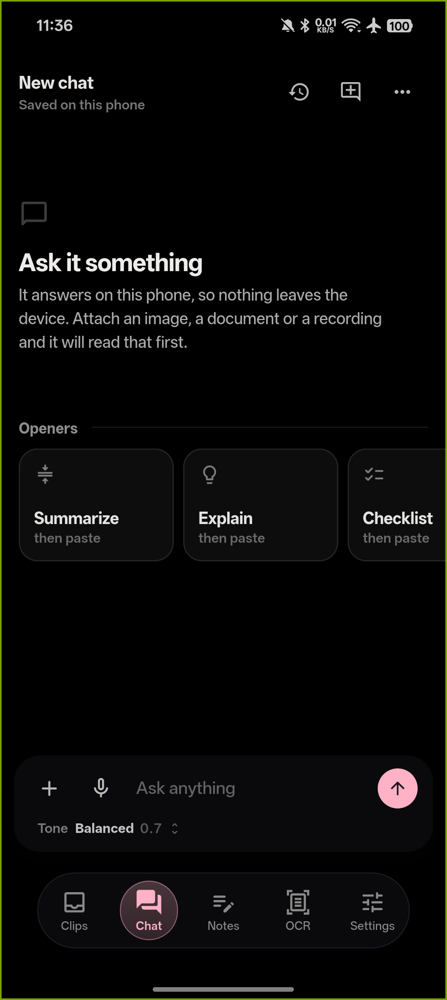
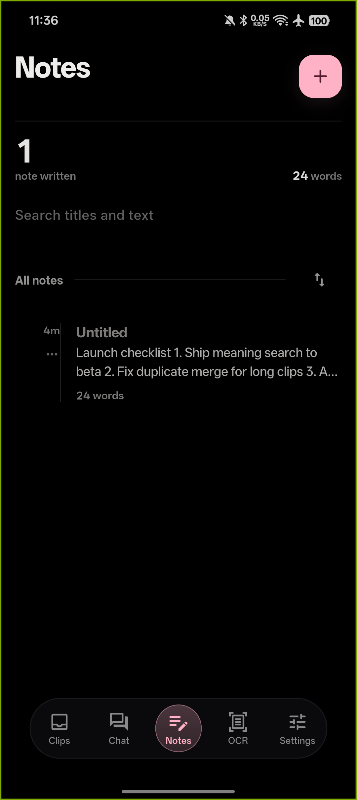
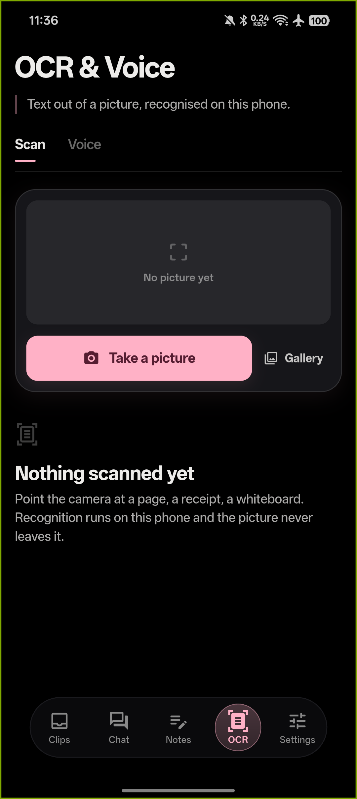
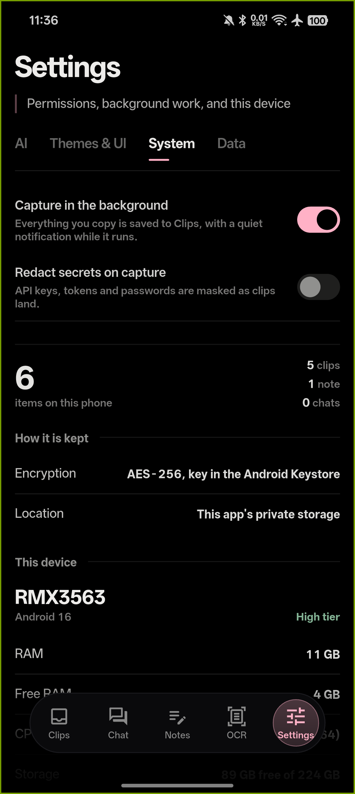
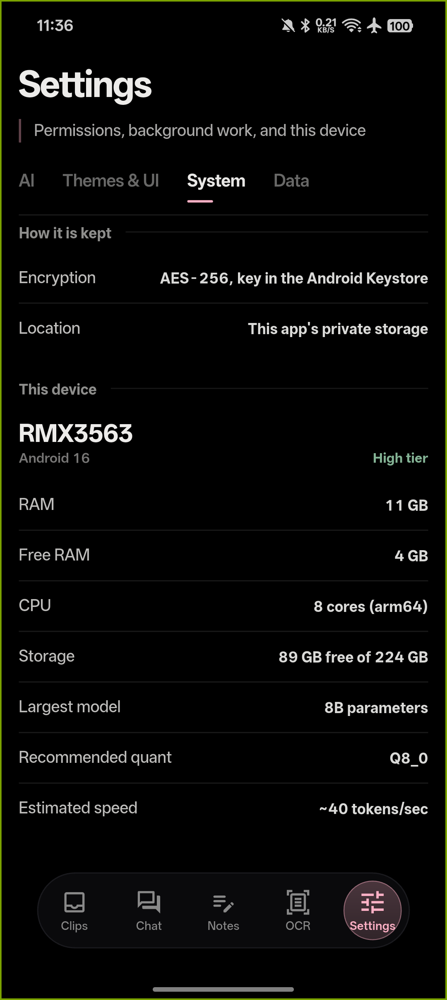
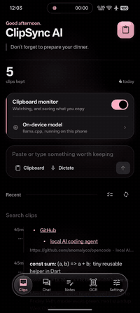

# ClipSync AI

**A clipboard manager that does its thinking on your machine.**

I built ClipSync AI because most clipboard tools treat the clipboard as raw material for a cloud service. Mine doesn't. Everything it saves stays in a local, encrypted box, the AI runs inside the app, and the whole thing keeps working with the network unplugged.

No account. No telemetry. No server that has to be up for the app to be useful. Cloud providers are supported if you want them, but they're off until you turn them on, and the app asks twice before sending anything.

<p align="center">
  
  
  
  
  
  
</p>

---

## Launch video

<p align="center">
  <a href="https://github.com/venudinesh/clipsync/raw/refs/heads/main/screenshots/demo-pc.mp4">
    
  </a>
</p>
<p align="center">
  <a href="https://github.com/venudinesh/clipsync/raw/refs/heads/main/screenshots/demo-phone.mp4">
    
  </a>
</p>

<p align="center">
  <em>Desktop (16:9) and phone (9:16). Both autoplay and loop here; click one for the full-resolution version with sound.</em>
</p>

---

## Screenshots

<p align="center">
  
  
  
</p>
<p align="center">
  
  
  
</p>

<p align="center">
  <em>Real device, airplane mode.</em>
</p>

## Video walkthrough

<p align="center">
  <a href="https://github.com/venudinesh/clipsync/raw/refs/heads/main/screenshots/walkthrough.mp4">
    
  </a>
</p>

<p align="center">
  <em>About ten seconds across every screen, recorded on the phone.</em>
</p>

---

## What it does

You copy things all day. ClipSync keeps them, cleans them up, and makes them searchable:

- **Copy anything.** It gets saved automatically, including text copied in other apps. On Android 10 and newer the system only allows clipboard reads while the app is focused, so those builds catch up when you return, or through the share sheet and tile.
- **Summarise, tidy, or retitle it.** A model running on your device does the work in a few seconds.
- **Chat with your clips.** Ask questions, or attach a document, a photo, or a voice note.
- **Keep notes.** Tags, search, and the same AI help inside the editor.
- **Scan and dictate.** Point the camera at text or just talk. Both work offline.
- **Join clips.** Pick two or more and merge them, oldest first.
- **Redact secrets.** One tap masks API keys, tokens, passwords, and card numbers. Turn on auto-redact and they never reach storage.
- **Search by meaning.** Download the small indexing model and the feed ranks by what clips mean, not only by the words they contain.
- **Lock it.** A PIN over the whole app, with fingerprint or face unlock where the device has it.

The original is never replaced. Every AI result sits beside the text you copied, so you can compare, copy the old one, or throw the new one away.

## Two apps, one repo

This repository builds two codebases. They share the product, not the code:

**📱 Android** is a Flutter app that loads a GGUF model into llama.cpp inside its own process. Depending on your RAM, that means anything from Qwen 0.5B up to Llama 7B. The phone is the server, and there is no other server.

**🖥️ Windows** is a native C# program, about 23 MB, with no installer. It carries the llama.cpp runtime inside the executable and unpacks it on first use, the same way the phone build carries it in the APK. You can pick a model from the built-in catalogue (it downloads with a progress bar) or import one you already have. It also talks to a local Ollama/LM Studio/llama.cpp/Jan server, or to a cloud provider you configure yourself. With no model at all, a built-in engine still cleans, classifies, and tags every clip, and the UI hides the buttons that would need one.

**🐧 Linux and 🍏 macOS** use the Flutter app, built for desktop. Linux produces a `.deb`, an `.rpm`, and a portable tarball with the usual `/usr/lib/clip-sync-ai` layout; macOS produces `.dmg` and `.zip` for Apple Silicon and Intel. Both are built in GitHub Actions, so you don't need a Linux box or a Mac to ship them. See [Build it yourself](#build-it-yourself).

Nothing leaves either app unless you explicitly turn on a cloud provider or point it at a server. That path is opt-in, confirmed, and easy to turn off. The default is local.

## How your stuff stays yours

- **Inference is local.** The model lives in the app's folder. Your text goes in, the answer comes out, and no part of that loop needs a network.
- **Storage is encrypted.** Clips, notes, chat history and settings are sealed with AES-256, each box with its own key. On Android the keys live in the system keystore; on macOS in the Keychain; on Windows they're protected by DPAPI and the app also has a PIN lock.
- **Secrets get caught before storage.** Auto-redact masks API keys, tokens, passwords, and card numbers before a clip is written. Clips can also expire: keep them forever, a day, a week, or a month.
- **You can verify it.** Turn on airplane mode. Everything keeps working except downloading new models. That is the whole privacy check, and it takes ten seconds.

## A quick tour

**Clips** is the clipboard history. It's searchable, pinnable, and ranked so a hit in the title beats a hit in the body, and a rare word beats a common one. Load the indexing model and search becomes semantic: "that AWS key from last week" can find the key. Every clip gets a title and tags at capture time (written by the model when one is loaded). Any entry can be cleaned up, summarised, retitled, joined with another, or redacted. Saving something twice asks whether to keep both, merge, or discard. Delete has an undo, because everyone fat-fingers sometimes.

**Chat** is a normal conversation with the model, streamed as it writes and rendered as markdown. Attach a document, a photo (read by on-device OCR first), a voice note (transcribed first), or paste text. Long-press a message to copy it, summarise it, save it to notes, or regenerate the reply.

**Notes** is a markdown editor with tags and search. The AI bar can summarise, expand, fix grammar, or pull out action items, and every one of those changes can be undone.

**Capture** handles OCR and voice. Scan text from a photo, select a region of the screen on desktop, or dictate instead of typing. Results are editable before you save them, because recognition is not perfect and pretending otherwise would just waste your time. On Android you can also share text into Clips from another app's share sheet, or capture the clipboard from a Quick Settings tile without opening the app.

**Settings** has four tabs. AI covers models, downloads, device advice, server connections, and the meaning-search model. Themes & UI is colours, glass, and layout. System has the clipboard service, permissions, and redact-on-capture. Data has the privacy lock, clip lifetime, markdown export, and the wipe button. The model-connection dialog has presets for OpenAI, Gemini, Claude, Groq, Mistral, xAI, OpenRouter, and custom OpenAI-compatible endpoints, and it asks before any chat leaves the machine.

## The look and feel

I rebuilt the interface around one design system so the screens feel like they belong together:

- **Liquid Glass navigation.** A floating glass capsule with a lensed rim, refraction, and a bit of chromatic shimmer on modern Android. Nine sliders and a live preview if you like to tune it.
- **Eight muted accents.** Rose Quartz is the default, and each colour is checked for contrast automatically.
- **AMOLED black** on OLED screens, warm off-black elsewhere. No pure-black flatness and no glow.
- **Desktop differences.** On Windows the capsule becomes a left rail, swipes become hover actions, the camera becomes screen-region capture, and there are global hotkeys: `Ctrl+Shift+V` to summon it, `Ctrl+Shift+C` to tidy the clipboard, `Ctrl+Shift+H` for a Win+V-style history popup that pastes back into whatever you were doing. Plus a tray icon. A mouse is not a thumb.

## What's rough

Things I know aren't finished, in case you're deciding whether to use or contribute:

- `lib/main.dart` is still one very large file. It ships, and the tests cover it, but it should be split by feature.
- The Windows app has no semantic search and no Windows Hello. Its embedded runtime has no embedding path, and Hello needs the Windows SDK, which the zero-install build deliberately avoids.
- Android 10 and newer do not allow background clipboard reads. The always-on service only runs on Android 9 and older; newer versions capture when you return to the app, from the share sheet, or from the Quick Settings tile.
- The macOS builds are unsigned apart from an ad-hoc signature, so the first launch needs right-click → Open.
- There is no iOS target in the repo yet.
- Voice input is hidden on Linux because Whisper has no Linux build.

## Build it yourself

### Android

You need the Flutter SDK (`stable`) and the Android SDK with platform 36:

```bash
flutter pub get
flutter build apk --release
```

The APK lands at `build/app/outputs/flutter-apk/app-release.apk`. Add `--split-per-abi` if you want smaller files.

Check the work:

```bash
flutter analyze && flutter test
```

### Windows

You need nothing installed. The C# compiler ships with Windows:

```cmd
windows\build.cmd
```

That runs all 600 tests first and stops if any fail, then writes both executables to `windows/build/`, each with the llama.cpp runtime embedded. Use the x64 build if you plan to run embedded models; x86 works everywhere else.

If you want to build with a modern compiler, point `CSC` at a Roslyn `csc.exe` and the same sources compile as C# 7.3 instead of the in-box C# 5. The target stays .NET Framework 4.0 either way. `windows\sign.cmd` signs the executables with Authenticode if you give it a certificate; without one it does nothing.

### Linux and macOS (GitHub Actions)

Desktop binaries are built in the cloud. The workflow is at [`.github/workflows/desktop.yml`](.github/workflows/desktop.yml) and produces:

| Artifact | Platform | Notes |
|:--|:--|:--|
| `clip-sync-ai_<ver>_amd64.deb` | Linux x86_64 | Installs to `/usr/lib/clip-sync-ai`, with `/usr/bin` launcher, desktop entry, and hicolor icon |
| `clip-sync-ai_<ver>.x86_64.rpm` | Linux x86_64 | Same contents, RPM metadata |
| `clip-sync-ai-linux-x64.tar.xz` | Linux x86_64 | Portable bundle, runs after extraction |
| `ClipSyncAI_<ver>_macos_arm64.dmg` + `.zip` | macOS Apple Silicon | Built on `macos-14` |
| `ClipSyncAI_<ver>_macos_x64.dmg` + `.zip` | macOS Intel | Built on `macos-15-intel` |

To trigger a build, push the repository to GitHub with Actions enabled and use **Actions → desktop builds → Run workflow**. It also runs on every push to `main`.

A few packaging details:

- **Linux:** the `.deb` depends on `libgtk-3-0`, `libsecret-1-0`, and `zenity`; the RPM has the same requirements. Keys live in the Secret Service (GNOME Keyring and friends).
- **macOS:** builds are unsigned and then ad-hoc signed so the arm64 app can launch. On first run, right-click → **Open** to get past Gatekeeper. Touch ID works where the Mac has it.
- **Windows:** PIN only, because Windows Hello needs the full Windows SDK. Search is keyword-ranked rather than semantic, for the reason above. Same clips, slightly shorter feature list.

## What you'll need

**Android:** 7.0 or newer on a 64-bit ARM device · 4 GB RAM for small models, 6–8 GB+ for larger ones · 1–5 GB free for model files.

**Windows:** Windows 7 or newer, 32- or 64-bit · .NET Framework 4.0+ (already present on Windows 8 and up) · about 23 MB for the exe, plus whatever a model weighs. Embedded models need the 64-bit build.

**Linux (from the `.deb`/`.rpm`):** glibc 2.28+, GTK 3, a Secret Service daemon, and `zenity`. Vulkan is fine; there's an OpenGL fallback.

**macOS:** 12.0 (Monterey) or newer, Apple Silicon or Intel.

## One honest note

Fresh unsigned builds sometimes look suspicious to antivirus, Malwarebytes in particular. An unknown program that watches the clipboard and registers hotkeys does sound like spyware until you look at what it does. It uses documented APIs, asks for no admin rights, and ships with version information. If your scanner complains, allowlist the file and consider [reporting the false positive](https://www.malwarebytes.com/support/false-positive). It helps every small developer shipping honest software.

## License

MIT. Do what you like, keep the notice.

## Disclaimer

**ClipSync AI is an open-source project provided "as is", without warranty of any kind, express or implied, including but not limited to the warranties of merchantability, fitness for a particular purpose, and non-infringement. The author and contributors are not liable for any damage, data loss, malfunction, or other consequence arising from installing, building, or using this software on any device. By downloading, installing, or using this software, you acknowledge that you do so entirely at your own risk. Back up your data before installing software from any source, including this repository.**
